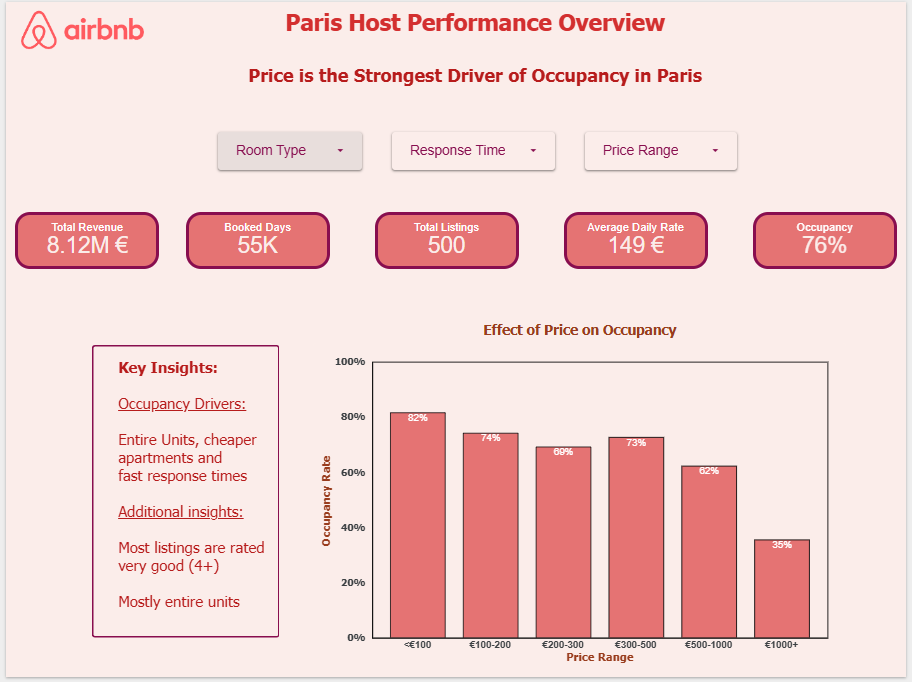

# Airbnb Paris – Host Performance Analysis

**Why do some Airbnb hosts in Paris rent more than others?**

An analysis for Airbnb's Customer Success team, built with **Google BigQuery (SQL)** and **Looker Studio** as part of the [Le Wagon](https://www.lewagon.com/) Data Analytics Bootcamp.

🔗 **[Interactive dashboard (Looker Studio)](https://datastudio.google.com/reporting/c9e97958-30b8-44df-95e2-2a2f8c4a8893)**



---

## Key findings

| Factor | Effect on occupancy | Evidence |
|---|---|---|
| **Price** | Strongest driver | Average occupancy falls from **82%** for listings under €100 to **59%** for listings above €500 |
| **Host response time** | Small but real, independent of price | Occupancy declines steadily from the fastest to the slowest responders, while average price does not (€155 → €179 → €143 → €140) |
| **Room type** | Mixed | Entire homes/apartments average **76%** vs. **71%** for private rooms, but private rooms do slightly better when hosts reply "within a few hours" or "within a day" |
| **Review score** | No meaningful effect | Scores are clustered between 4 and 5, so they don't separate high and low performers |

### Occupancy by price range

| Price range (avg. nightly price) | Listings | Avg. occupancy |
|---|---:|---:|
| < €100 | 182 | 82% |
| €100–200 | 223 | 74% |
| €200–300 | 54 | 69% |
| €300–500 | 24 | 73% |
| > €500 | 17 | 59% |

**Recommendation:** Customer Success should focus on guiding overpriced and slow-responding hosts toward pricing adjustments and faster response times, rather than on review scores.

---

## Dataset

Two tables of Airbnb listings in Paris (provided by Le Wagon):

| Table | Rows | Columns |
|---|---|---|
| `listing` | 500 | `id`, `room_type`, `host_response_time`, `review_scores_value` |
| `calendar` | 72,101 | `listing_id`, `date`, `available`, `price` |

- Period: **9 Sep 2022 – 31 Jan 2023**
- Data quality checks: no NULLs in the key columns, `listing.id` is unique, and `listing_id` + `date` is unique in `calendar`

---

## Approach

### 1. Data modeling in BigQuery

I organized the project in three layers, following a staging → intermediate → mart pattern:

```
raw_data          → original tables (listing, calendar)
intermediate      → views: stg_listing, stg_calender, listing_calender_joined
mart              → host_performance (one row per listing, ready for BI)
```

- **Staging views** select and document the raw columns and their grain ([01](sql/01_stg_listing.sql), [02](sql/02_stg_calendar.sql)).
- **`listing_calender_joined`** joins each listing to its daily calendar records ([03](sql/03_listing_calendar_joined.sql)). The result has 72,101 rows, matching the calendar table, so no rows were lost or duplicated.
- **`mart.host_performance`** aggregates to one row per listing ([04](sql/04_mart_host_performance.sql)):

| Column | Description |
|---|---|
| `id`, `room_type`, `host_response_time`, `review_scores_value` | Listing attributes |
| `total_days` | Days in the calendar period |
| `booked_days` | Days the listing was not available (`available = FALSE`) |
| `occupancy_rate` | `booked_days / total_days` |
| `avg_price` | Average nightly price |

### 2. Analysis

- Grouped listings into price ranges and compared average occupancy ([05](sql/05_host_performance_bucketed.sql))
- Compared occupancy and average price across host response times, with the number of listings per group ([06](sql/06_response_time_summary.sql))
- Compared occupancy across room types and review scores
- Checked correlations: price vs. occupancy **-0.19**, review score vs. occupancy **0.13**. Both are weak at the individual-listing level, which is why the grouped view by price range is more informative.

### 3. Dashboard (Looker Studio)

| Page | Content |
|---|---|
| **Introduction** | KPIs (total revenue €8.12M, 55K booked days, 500 listings, €149 average daily rate, 76% occupancy), filters, occupancy by price range |
| **Analysis** | Price vs. occupancy scatter plot, occupancy by room type, occupancy by response time and room type, occupancy and price by response time |
| **Conclusion** | Findings and recommendation |

---

## Limitations

- **Small groups:** The most expensive range (> €500) contains only 17 listings. An earlier version split it further into €500–1,000 and €1,000+, but the €1,000+ group had only 2 listings, so I merged them to avoid drawing conclusions from too few data points. Shared rooms (1 listing) were excluded from the room-type comparison.
- **Booking window:** Occupancy appears to drop from September to January, but this is most likely because later dates had not been booked yet when the data was collected, not because of real seasonality. I therefore left the monthly trend out of the main findings.
- **Correlation, not causation:** The analysis shows associations. Price changes would need to be tested (e.g. with an A/B test) before concluding that they cause higher occupancy.

---

## Repository structure

```
├── README.md
├── sql/
│   ├── 01_stg_listing.sql
│   ├── 02_stg_calendar.sql
│   ├── 03_listing_calendar_joined.sql
│   ├── 04_mart_host_performance.sql
│   ├── 05_host_performance_bucketed.sql
│   └── 06_response_time_summary.sql
└── images/
    ├── 01_introduction.png
    ├── 02_analysis.png
    └── 03_conclusion.png
```

## Tools

Google BigQuery (SQL) · Looker Studio · Data modeling (staging / intermediate / mart)

---

**Author:** Can Mengus · [LinkedIn](https://linkedin.com/in/canmengus) · [GitHub](https://github.com/CanMengus)
